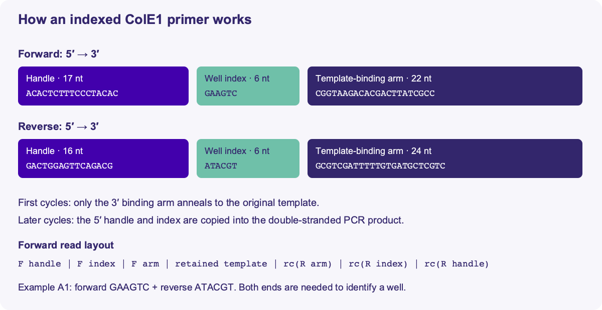
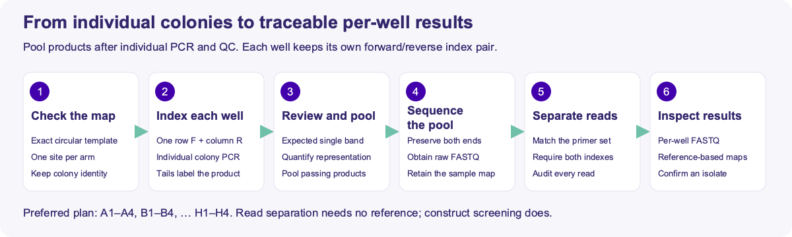
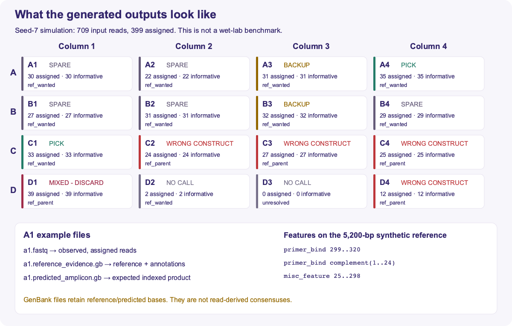
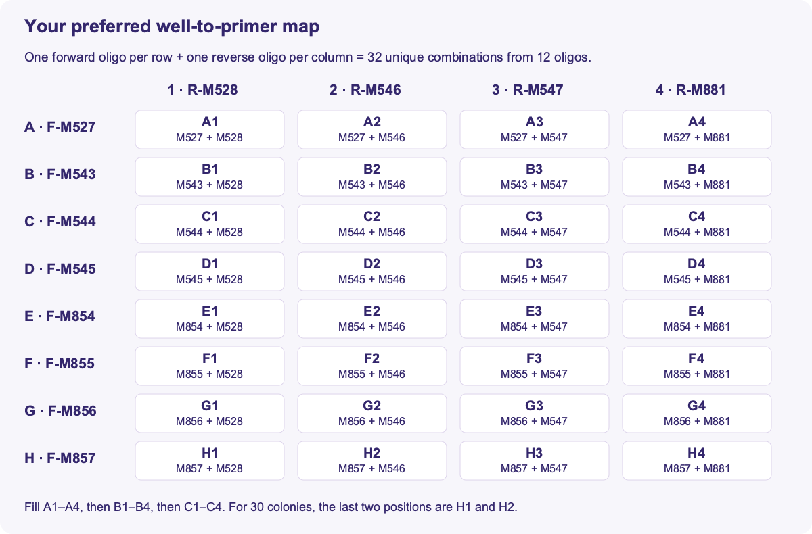
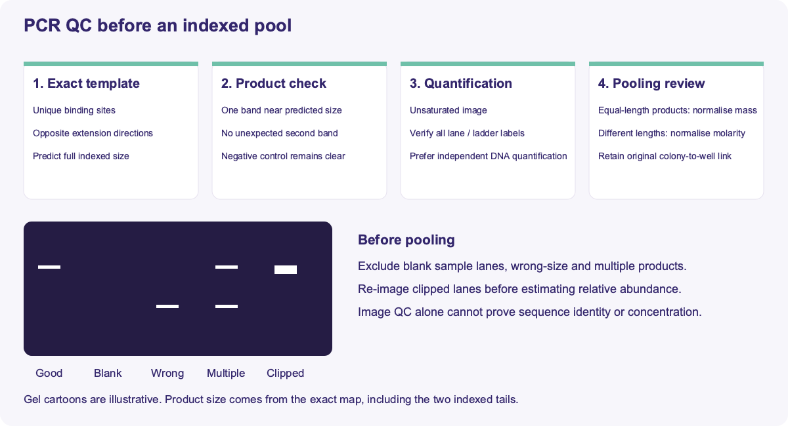
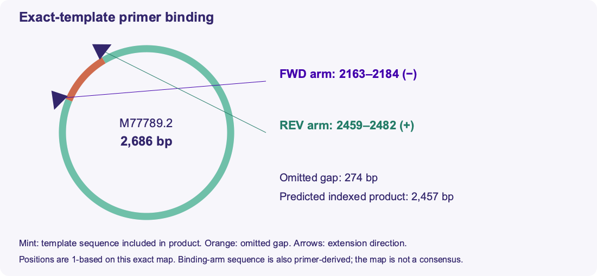

<p align="left"></p>

# Aureka Pooled Clone Sequencing

[](https://github.com/Drjackxiaoyuchen/aureka-pooled-clone-seq/actions/workflows/ci.yml)
[](LICENSE)
[](pyproject.toml)

Screen indexed colony-PCR amplicons from a pooled long-read FASTQ and produce an interactive, printable plate report. The preferred layout provides **32 positions from 12 oligos** (8 forward × 4 reverse); the full catalog provides 48 combinations from 14 oligos. Achievable multiplexing depends on PCR, pooling and informative sequencing yield.

**[Open the synthetic demo](https://drjackxiaoyuchen.github.io/aureka-pooled-clone-seq/)** · [Bench guide](docs/01_bench_protocol.md) · [中文流程](docs/01_bench_protocol_zh.md) · [Review and limitations](docs/REVIEW.md)

**Order ColE1 now:** [12 required sequences](primers/ColE1_ORDER_32well.txt) · [Excel order + A1–H4 well map](primers/Aureka_ColE1_32well_Order.xlsx).
The preferred layout is **A1–A4, B1–B4, … H1–H4**: eight forward and four reverse oligos. The final two reverse oligos in the workbook are optional expansion to columns 5–6.

[](assets/graphics/primer_architecture.svg)

Only the 3′ arm binds the original template. The 5′ handle and index are incorporated into the PCR product; both end indexes identify the source well. Figures link to their editable SVG versions.

[Binding sites and mechanism](docs/06_MECHANISM_AND_BINDING.md) · [PCR QC guide](docs/07_PCR_QC_GUIDE.md) · [Output and annotated GenBank guide](docs/08_OUTPUTS_AND_GENBANK.md) · [v0.3 demultiplexing review](docs/09_DEMULTIPLEX_REVIEW.md)

[](assets/graphics/workflow_overview.svg)

This is an experimental **reference-discrimination screen**. It does not assemble a consensus, discover novel mutations, or certify a plasmid sequence. A `PICK` is a candidate for independent confirmation. The AmpR primer set is a proposed, unvalidated design.

## Install

Linux or macOS, Python 3.10 or newer. A C compiler may be needed to build `mappy` or `edlib`; on macOS install Xcode Command Line Tools if your Python lacks compatible wheels. Windows users should use WSL2; native Windows is not validated.

```bash
git clone https://github.com/Drjackxiaoyuchen/aureka-pooled-clone-seq.git
cd aureka-pooled-clone-seq
python3 -m venv .venv
source .venv/bin/activate
python -m pip install --upgrade pip
python -m pip install .
apcs --version
```

## Reproduce the demo

```bash
python demo/run_demo.py --out demo-output
```

Open `demo-output/sequencing/result/report/plate.html`. Select a well to see assigned, mapped and informative molecule counts, support, breadth and the reason for its verdict. CSV, Markdown and JSON reports are written beside it.

The seeded simulation contains 16 loaded wells: nine adequately covered wanted constructs, four parental constructs, one 50/50 input mixture, one low-depth well, and one empty well. The verifier checks every loaded well's outcome, not merely the presence of a `PICK`. A second simulated gel demonstrates size checks, multiple bands, no band, clipping and a pooling-volume cap. **All demo results are simulated; they are not a wet-lab performance benchmark.** Generated example outputs are in [demo/synthetic/result/report](demo/synthetic/result/report/00_PICK_THIS.md).

[](assets/graphics/demultiplex_output_preview.svg)

The preview is generated from the committed CSV and annotated GenBank output. Explore the [interactive plate](https://drjackxiaoyuchen.github.io/aureka-pooled-clone-seq/demo/plate.html), [per-well CSV](demo/synthetic/result/report/per_well.csv), [A1 reference-evidence GenBank](demo/synthetic/result/annotations/wells/a1.reference_evidence.gb), and [predicted A1 amplicon](demo/synthetic/result/annotations/wells/a1.predicted_amplicon.gb). Reference-evidence and predicted-product files are not read-derived consensuses.

## Use your own data

### Match each well to its two oligos

[](assets/graphics/plate_32well.svg)

Each well receives its row's forward oligo and its column's reverse oligo. Products are pooled after individual PCR and QC. For 30 colonies, the final two loaded positions are H1 and H2.

```bash
# Check compatibility for EACH exact circular plasmid sequence.
apcs check wanted.gb parent.gb --set cole1
apcs indexqc

# Plan up to 48 index combinations. Fill in sample names and optional expected
# reference filename stems in samples.csv; preserve the well/index assignments.
apcs plan -n 16 --set cole1 -o my-plan

# Demultiplex only: no plasmid reference is needed for read separation.
apcs demux pool.fastq.gz --samples my-plan/samples.csv --set cole1 -o separated

# Optional heuristic image review. Labels must cover EVERY sample lane.
# Use your actual ladder sizes, lane count, image and expected product size.
apcs gel gel.png --expected-bp 5000 --ladder-lane 0 \
  --ladder-sizes 10000,5000,2000,500 --no-crop -o my-gel

# Request pooled amplicon sequencing that retains both indexed ends.
apcs run pool.fastq.gz --samples my-plan/samples.csv --set cole1 \
  --expect wanted.gb --also parent.gb -o my-screen
```

### Check the PCR products before pooling

[](assets/graphics/pcr_qc_guide.svg)

The gel cartoons are illustrative. Determine the expected size from the exact map, including the indexed tails. Review controls, ladder assignments, sample labels and unsaturated abundance measurements before pooling. A band near the expected size does not establish sequence identity. See the [PCR QC guide](docs/07_PCR_QC_GUIDE.md).

Use fresh output directories; existing plans or sequencing outputs are protected against overwrite. The sample sheet is authoritative: unused combinations are monitoring positions, not evidence of an exact contamination rate. At 48 loaded combinations there are no unused sentinels.

`apcs order --set cole1 -o my-order` exports CSV and XLSX order sheets. Review exact-template matches and supplier requirements before ordering. `--set ampr` exports the proposed AmpR design, whose experimental performance has not been established.

The order command defaults to four reverse indexes (12 oligos total); `--columns 6` includes all 14. `apcs plan` defaults to the four-column layout (32 positions); `--layout row` enables the six-column grid. Well IDs are case-insensitive.

`apcs annotate template.gb --set cole1 --well a1 -o annotated-map` writes an annotated circular reference, a predicted indexed linear amplicon and an exact-map binding SVG. `apcs run` also writes a reference-evidence GenBank and an alignment-span track for every loaded well. Select a well in the HTML report for downloads. **These are annotated reference/prediction files, not read-derived consensuses.** Original features are preserved when supplied in GenBank; missing gene identities are not invented.

### See the binding sites on an exact template

[](demo/pUC19/annotated/primer_binding.svg)

On public pUC19 **M77789.2**, the forward arm binds complement(2163..2184), and the reverse arm binds 2459..2482. The omitted gap is 274 bp; the full indexed product is **2457 bp = 2686 − 274 + 45**. These coordinates apply to this exact reference. The 46 annealing-arm bases are supplied by the oligos and do not independently verify the original template.

Open the [annotated circular pUC19 map](demo/pUC19/annotated/reference_annotated.gb) or [predicted indexed A1 product](demo/pUC19/annotated/a1_predicted_amplicon.gb). The [binding guide](docs/06_MECHANISM_AND_BINDING.md) explains the strand directions and omitted region.

## How calls work

Both indexes must be supported by primer-arm anchors near opposite read ends. The default requires exact six-base indexes; `--index-mismatch 1` explicitly enables one-substitution recovery. Actual aligned arm spans handle indels, and equal-best competing wells are rejected. No setting guarantees recovery of every error pattern or prevention of all cross-assignment.

Related references are aligned as circular sequences. Diagnostic windows include substitutions and small indels, excluding the omitted gap and primer-overwritten arm bases; each allele is explicitly scored, and **each read contributes at most one reference vote**. Ties, identical references, and missing diagnostic coverage do not become confident construct calls. One related-backbone group plus unrelated alternatives is supported; partial homology and additional related groups can require separate panels.

| Verdict | Meaning |
|---|---|
| `PICK` / `PICK (low depth)` | Passed the configured screen; shortlist for confirmation |
| `BACKUP` | Lower-ranked passing candidate, or evidence requiring review |
| `SPARE` | Additional passing candidate |
| `WRONG CONSTRUCT` | A supplied alternative dominates the informative votes |
| `MIXED - DISCARD` | Mixed reference evidence; re-streak and confirm rather than using this well directly |
| `NO CALL` | Insufficient or ambiguous evidence |
| `NOT USED` | Unloaded index combination |

Defaults are heuristics, not calibrated sensitivity or specificity. Read [analysis](docs/03_analysis.md), [decision rules](docs/04_decision_rules.md) and [failure modes](docs/05_failure_modes.md). Raw assignment counts, mapped counts, informative counts and coverage depth are distinct endpoints.

## Development

```bash
python -m pip install '.[dev]' build
python -m pytest -q
python demo/run_demo.py --out another-fresh-directory
python -m build
```

See [CONTRIBUTING.md](CONTRIBUTING.md). CI tests Python 3.10, 3.12 and 3.13 on Linux, builds the package and verifies the synthetic examples. The documentation site publishes a synthetic report generated from the same commit.

## Provenance and license

The ColE1 primer/index design and workflow inspiration are credited to Derek Sprayberry Aspacio's [pooledpremiumpcrpipeline2](https://github.com/daspacio9/pooledpremiumpcrpipeline2). Primer/index sequences were checked against its public source on 2026-11-16. This package uses minimap2 through `mappy` and Edlib; it does not run the upstream Snakemake/Medaka consensus pipeline. No head-to-head performance claim is made.

Software and documentation: [MIT](LICENSE); upstream notice: [THIRD_PARTY_NOTICES.md](THIRD_PARTY_NOTICES.md). Aureka's name and logo identify the project; no trademark rights are granted. Examples contain generated reads/images and a separately labelled public pUC19 reference, with no internal plasmid maps or experimental sequencing files.
