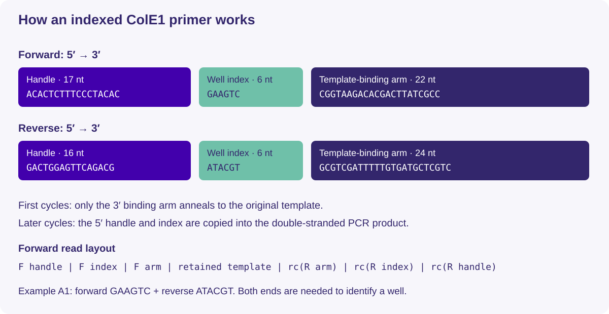
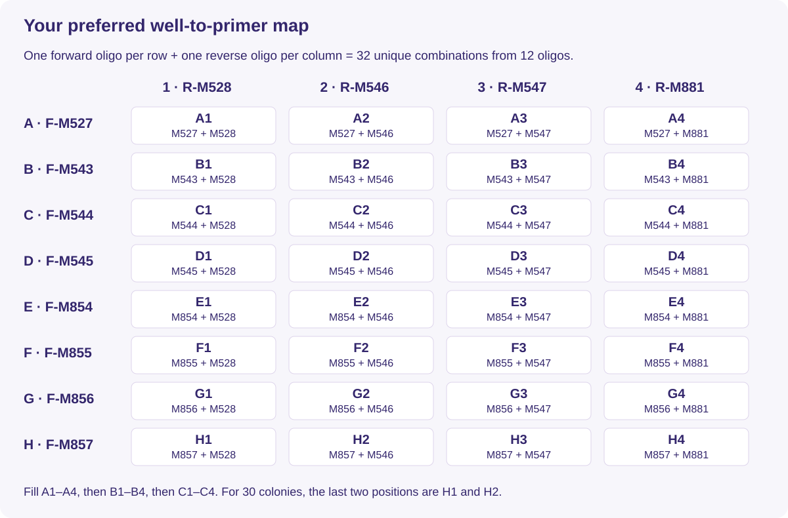
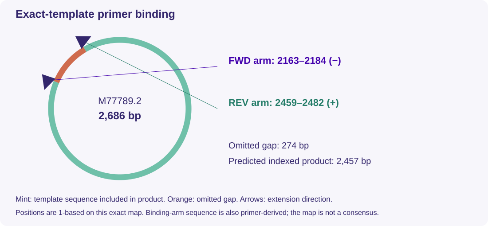

# Primer binding and the mechanism

Each well receives its row's forward primer and its column's reverse primer. The template-binding 3′ arm anneals to the circular plasmid. Extension proceeds away from the short interval between the two arms, around the retained part of the circle. The non-template 5′ handle and six-base index are incorporated into later PCR products. Individual PCRs are reviewed and then pooled; the resulting long reads carry a forward/reverse index pair identifying the source well.

Both ends are required: a forward index alone identifies a row; a reverse index alone identifies a column. The reverse end appears reverse-complemented in a forward-oriented read. A1 therefore uses forward GAAGTC plus reverse ATACGT, even though the latter appears as ACGTAT on the forward read strand.

The preferred plan is A1–A4, B1–B4, … H1–H4. This needs eight forward plus four reverse oligos. Column 5 and 6 indexes remain in the full index catalog as optional expansion; the decoder still monitors all 48 combinations. Old assignments in columns 1–6 keep their original identities. For 30 colonies, the final two loaded positions are H1 and H2.

## Exact-map example

Public [pUC19 M77789.2](https://www.ncbi.nlm.nih.gov/nuccore/M77789.2) is 2686 bp. The forward arm binds complement(2163..2184), and the reverse arm binds 2459..2482. The omitted interval is 2185..2458 (274 bp). The predicted indexed product is **2457 bp = 2686 − 274 + 45**. These coordinates belong to this accession and origin convention; check every actual vector map separately.

The 274-bp gap is absent. The 22 + 24 arm bases are supplied by the primers and cannot independently prove the original template sequence either. Version 0.3 masks both classes when constructing diagnostic windows. For this example that leaves 2366 template bases eligible for independent read evidence.

Download [annotated circular reference](../demo/pUC19/annotated/reference_annotated.gb) and [predicted A1 amplicon](../demo/pUC19/annotated/a1_predicted_amplicon.gb). Open the `.gb` files in a GenBank-compatible editor. Original input annotations are retained; the program adds its own clearly named overlays rather than inferring missing gene identities.
