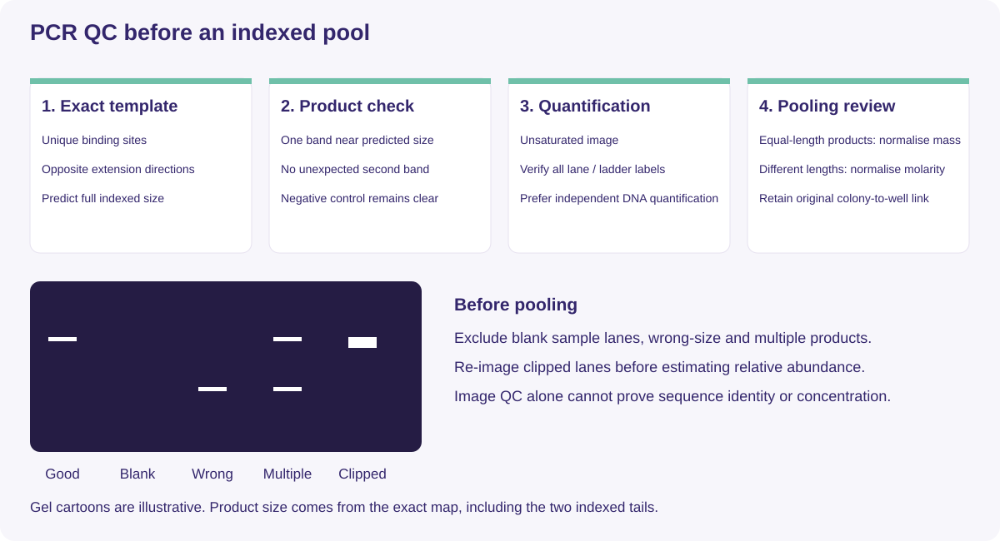

# PCR QC and pooling guide

Record the exact reference version, primer set, original colony identity and well assignment before PCR. The row/column index pair is sample identity, so changes must be reflected in the sample sheet.

| Check | Pass for pooling | Hold and investigate |
|---|---|---|
| Template compatibility | One exact site per arm, opposite extension directions, plausible predicted product | No/duplicate sites, incompatible primer set or unexpected product length |
| Positive control | Expected product with the chosen preparation and enzyme | Amplification failure; interpret sample negatives cautiously |
| No-template control | No detectable product | Product suggests reagent/carryover contamination; investigate before using the pool |
| Sample band | One discrete band near the full predicted indexed length | Missing band, wrong size, strong second band or unresolved smear |
| Image/calibration | All ladder bands and sample labels verified; bands inside the sizing range | Missing ladder bands, ambiguous lane count or extrapolated size |
| Abundance estimate | Unsaturated signal under comparable loading, preferably independent DNA quantification | Clipped/saturated image or inconsistent loading; relative intensity is unreliable |
| Pool | Normalised representation, adequate final concentration/volume for the provider | An individual product dominates, required volume exceeds availability/cap, or submission requirements are unmet |

The program's default ±20% gel-size tolerance is a screening heuristic, not a demonstrated gel resolution. Choose a tighter, assay-appropriate acceptance window only after checking ladder fit and the expected product sizes. Similar-size wrong constructs can pass a gel; reference comparison is a separate step.

## Product length

Use the full indexed product predicted by `apcs check`, not the plasmid size alone. The supplied ColE1 set adds 17 + 6 + 6 + 16 = 45 bases in the two tails. For pUC19 M77789.2, the full product is 2457 bp. The nominal 274-bp gap is not guaranteed on every ColE1-labelled vector.

## Choosing PCR conditions

Use the current instructions for the exact polymerase and template preparation in your lab. Determine initial annealing conditions from the template-binding arms, and extension requirements from the predicted product length. A direct-colony sample and purified plasmid can behave differently. The generic [NEB PCR optimisation guidance](https://www.neb.com/en-ca/tools-and-resources/usage-guidelines/guidelines-for-pcr-optimization-with-thermophilic-dna-polymerases) is a starting reference; this repository does not claim one validated program for every colony, enzyme, vector or primer set.

## Quantification and representation

For equal-length amplicons, equal DNA mass gives equal molecule count. For different lengths, compare mass divided by length. If a product has concentration C ng/µL and length L bp, its approximate double-stranded DNA concentration is `C × 10^6 / (660 × L)` nM. Choose pooling volumes to contribute comparable molecule amounts; respect actual available volumes and confirm the final pool independently.

The image helper assumes comparable sample loading and equal-length products. Its relative volumes are suggestions, not a final submission concentration. It withholds a volume for missing calibration, clipping and volume-cap cases. Review the actual image and lane linkage before accepting any suggestion.

Select a sequencing preparation that preserves both indexed ends, request the raw FASTQ, and verify current [provider requirements](https://plasmidsaurus.com/sample-prep/amplicon). Mean pool depth is not the poorest well's depth. A planning expectation is total reads × assignment fraction × informative fraction / loaded wells; pilot data are needed for each assay.

After analysis, recover the original isolate linked to a selected well and confirm the plasmid sequence independently. PCR QC, reference discrimination and base-level sequence verification answer different questions.
